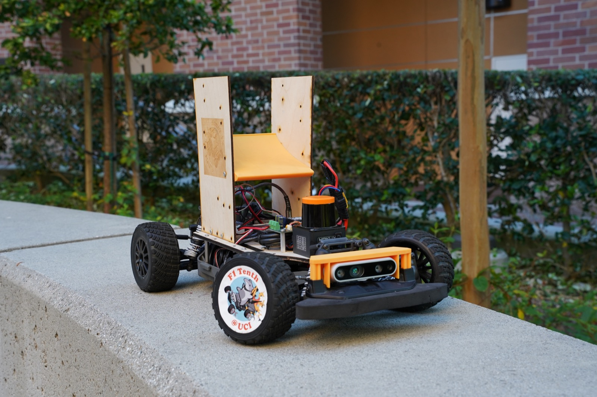
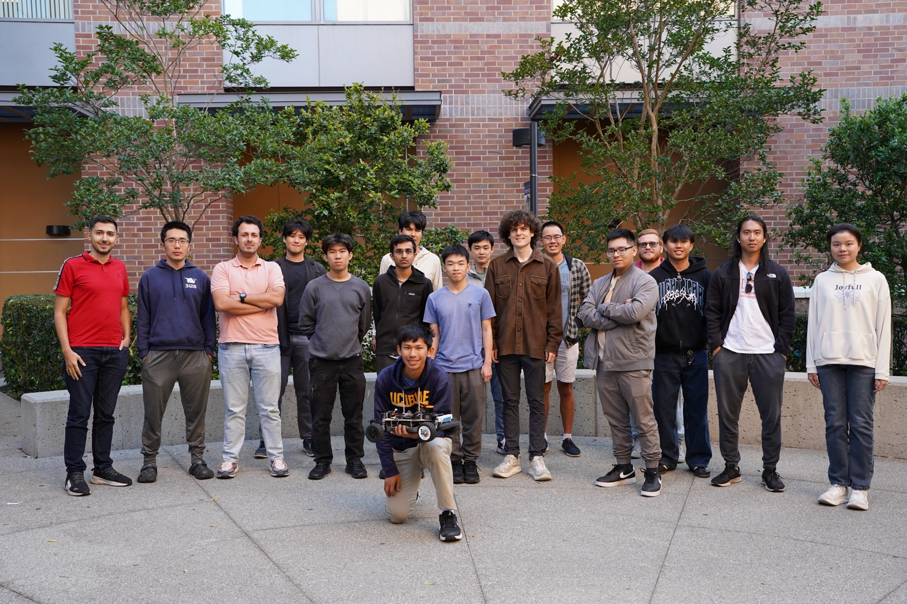

# Speed through code

Help UC Irvine students turn autonomous racing research into real performance on the track.

{width=5.8in}

**4th internationally** at an IEEE F1TENTH competition  
**1:10-scale vehicles** built for autonomous racing  
**HCB fiscal sponsorship** through The Hack Foundation

F1TENTH@UCI is the autonomous racing team at the University of California, Irvine. We bring together software, artificial intelligence, electronics, and mechanical design to develop cars that navigate and race autonomously.

Our team competes in F1TENTH, now known as RoboRacer. Our research focuses on reinforcement learning: training driving policies in simulation and bringing them onto real vehicles.

We are seeking financial and in-kind sponsors to help us build on our fourth-place international finish, strengthen our racing platform, and create more opportunities for students to work with autonomous systems.

**Let's build the next lap together.**  
[f1tenth@uci.edu](mailto:f1tenth@uci.edu) | [f1tenth.club](https://f1tenth.club)

# What your support makes possible

## From simulation to the starting line

Our engineering work connects three layers:

| Layer | Our work |
|---|---|
| Learn in simulation | Reinforcement learning research using PPO and DreamerV3; development in our custom Warporacer simulator and validation in AutoDrive. |
| Build the vehicle | NVIDIA Jetson computing, Hokuyo LiDAR, VESC motor control, and a ROS 2 software stack; student work in CAD, PCB design, and mechatronics. |
| Test on the track | Integrating perception, planning, control, and telemetry to understand how simulation-trained driving behaves on physical hardware. |

## Funding priorities

These are proposed areas for sponsorship support. We can discuss a contribution matched to your interests and our current needs.

| Priority | What support would help cover | Intended impact |
|---|---|---|
| Vehicle hardware and reliability | Sensors, onboard computing, motor controllers, batteries, tires, and replacement parts | Keep vehicles available for development and reduce interruptions during testing. |
| Simulation and training | GPU or cloud compute and development tools | Support more training experiments and evaluation before track deployment. |
| Fabrication and testing | PCB fabrication, mechanical parts, prototyping materials, and track supplies | Give students more opportunities to build, test, and refine designs. |
| Competition participation | Registration, travel, lodging, and equipment transport | Help bring the team and its vehicles to future competitions. |

## Equipment and technical support

Potential contributions include compatible compute modules, LiDAR or other sensors, VESC-compatible components, batteries and chargers, tires, PCB fabrication, machining, and prototyping materials. We also welcome conversations about software access, compute credits, and technical mentorship.

Please contact us before sending equipment so we can confirm specifications, quantities, condition, and acceptance through our fiscal sponsor. Donated goods and donated services have different tax treatment; see the donation information below.

# A partnership built around student engineering

Support a team that gives students experience across the complete autonomy stack: learning algorithms, real-time software, electronics, and mechanical systems. Your contribution helps students test their ideas against the demands of a physical race car.

## Suggested contribution levels

**Draft proposal:** The amounts and recognition below are suggested starting points for team review. Final recognition and timing will be agreed with each sponsor before a commitment is accepted.

| Level | Suggested contribution (USD) | Proposed recognition |
|---|---|---|
| Supporter | $250–$999 | Name acknowledgment on the team website and a season-end impact update. |
| Partner | $1,000–$2,499 | Supporter recognition, with a website logo and a social media thank-you acknowledgment. |
| Champion | $2,500–$4,999 | Partner recognition, plus logo acknowledgment in team presentation materials. |
| Lead Sponsor | $5,000+ | Champion recognition, plus logo placement on a team vehicle or apparel where space and event rules permit. |

Contributions of any size are welcome. We can also discuss support for a specific engineering need. Recognition for accepted in-kind contributions is arranged individually; recognition levels do not establish a donation's tax value.

## Stay connected to the work

We propose sharing development updates, competition results, and a season-end account of what sponsor support helped make possible. We also welcome conversations with engineers interested in discussing the team's technical work.

{width=5.8in}

All proposed logo placement is subject to team approval, available space, applicable rules, and the sponsor's brand guidelines.

# Support F1TENTH@UCI

## Start with a conversation

1. **Choose a contribution.** Tell us whether you are interested in financial support, equipment, compute access, or another technical resource.
2. **Confirm the details.** We will discuss the current need, contribution amount or equipment specifications, recognition, and timing.
3. **Coordinate through HCB.** Contact us for the team's donation link or payment instructions. For donated equipment, we will coordinate acceptance and acknowledgment with HCB before delivery.

**Email [f1tenth@uci.edu](mailto:f1tenth@uci.edu) to discuss a sponsorship or request donation instructions.**

## Fiscal sponsorship and donation information

F1TENTH@UCI is fiscally sponsored through HCB by **The Hack Foundation (doing business as Hack Club)**, a 501(c)(3) public charity. The fiscal sponsor's EIN is **81-2908499**. Contributions should be coordinated through HCB for the benefit of F1TENTH@UCI. [About HCB fiscal sponsorship](https://help.hcb.hackclub.com/en/articles/15409723-what-is-fiscal-sponsorship-and-how-is-it-different-from-starting-my-own-501-c-3).

Eligible cash and donated-goods contributions may be tax-deductible to the extent allowed by law. Deductibility depends on the donor's circumstances and any goods or services received in return. The value of donated time or services generally is not deductible as a charitable contribution. Donors determine the value of donated property and are responsible for applicable tax documentation. [IRS guidance on charitable contributions](https://www.irs.gov/publications/p526).

HCB provides emailed receipts for monetary donations processed through its donation system. Noncash acknowledgments describe donated property without assigning its value; we will coordinate the appropriate documentation with our fiscal sponsor. [HCB donation receipts](https://help.hcb.hackclub.com/en/articles/15410030-how-do-donation-receipts-and-refunds-work) · [IRS written acknowledgments](https://www.irs.gov/charities-non-profits/charitable-organizations/charitable-contributions-written-acknowledgments).

## Meet the team online

- **Website:** [f1tenth.club](https://f1tenth.club)
- **Email:** [f1tenth@uci.edu](mailto:f1tenth@uci.edu)
- **Code:** [github.com/uci-f1tenth](https://github.com/uci-f1tenth)
- **Instagram:** [@f1tenthuci](https://www.instagram.com/f1tenthuci/)
- **YouTube:** [@F1TenthUCI](https://www.youtube.com/@F1TenthUCI)

**Help us turn the next experiment into the next lap.**

Team profile and photography: [f1tenth.club](https://f1tenth.club). This proposal is for F1TENTH@UCI; donations are coordinated through its fiscal sponsor.
